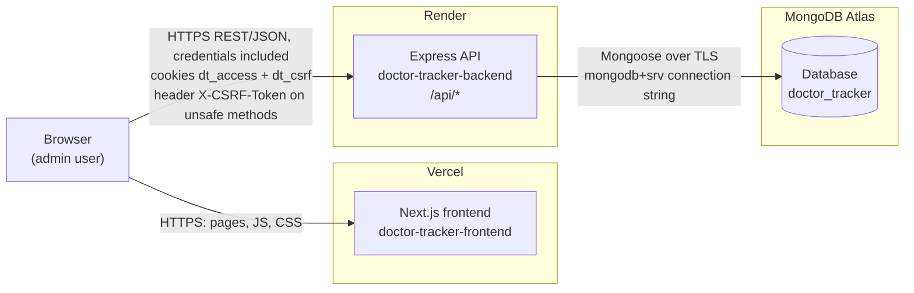
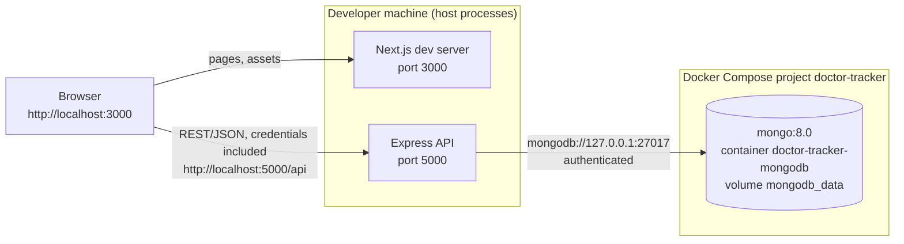
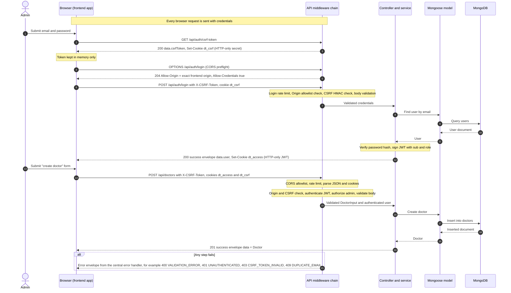
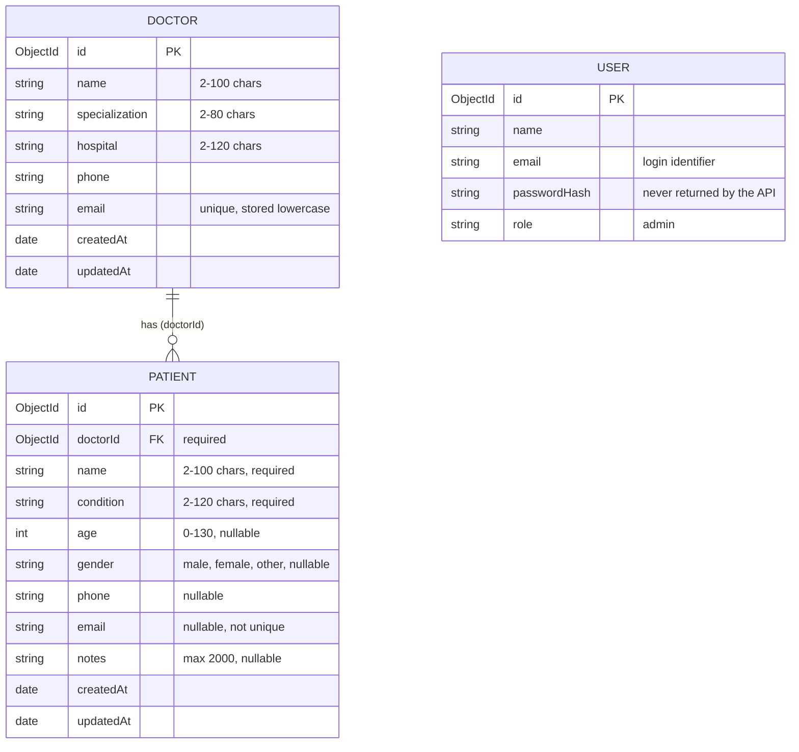
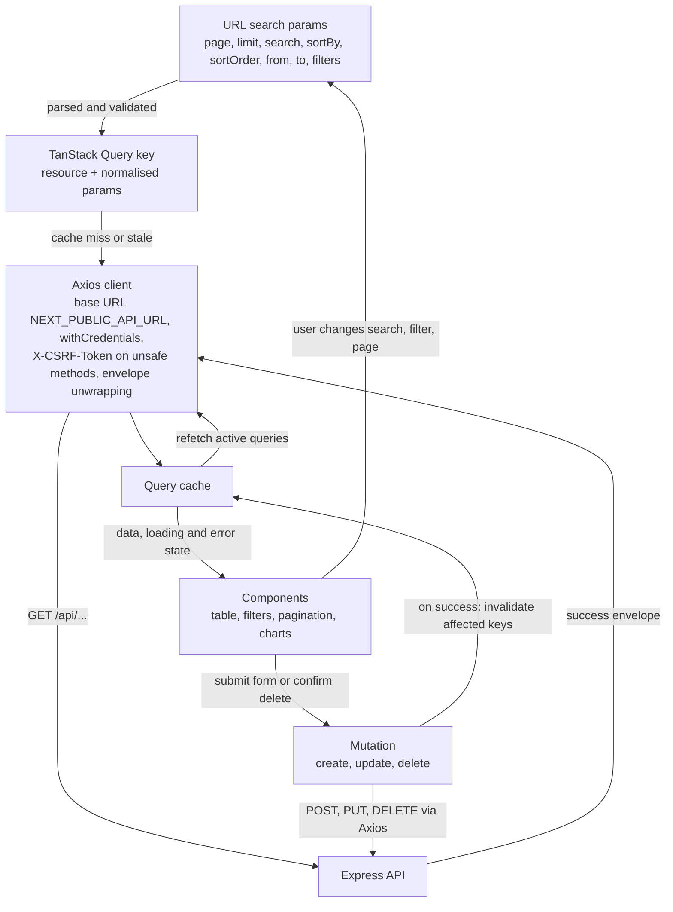

# Doctor Tracker — Architecture

This document describes the system at the level fixed by `API_CONTRACT.md`. Where an
implementation detail (file name, library version, index definition) is decided inside the
backend or frontend repository, this document states the contract-level behaviour only and
defers to that repository's README.

Related documents: `API_CONTRACT.md` (authoritative for endpoints, envelopes, cookies and
environment variables), `LOCAL_DEVELOPMENT.md`, `DEPLOYMENT.md`,
`PDF_REQUIREMENTS_TRACEABILITY.md`.

## 1. System overview

Doctor Tracker is an administrative web application in which an authenticated admin manages
doctors and the patients assigned to them, and reads aggregate statistics on a dashboard.

It consists of three separately deployed parts:

| Part | Repository / location | Responsibility |
|---|---|---|
| Frontend | `doctor-tracker-frontend` (Next.js, port 3000 locally) | UI, routing, client-side data fetching and caching. Holds no business logic and never talks to the database. |
| Backend | `doctor-tracker-backend` (Express + Mongoose, port 5000 locally) | REST API under `/api`: authentication, authorization, validation, business rules, aggregation. The only component that connects to MongoDB. |
| Database | MongoDB (`mongo:8.0` container locally, MongoDB Atlas in production) | Persistence for users, doctors and patients. |

The assignment requires a separate client application and a separate standalone server
communicating over REST (assignment page 5, rendered text). The two applications are
therefore independent repositories with independent builds, environment files and hosts.

Design properties that follow from the contract:

- **Stateless API.** The session is a JWT carried in an HTTP-only cookie. The backend keeps no
  server-side session store, so instances can be restarted or scaled horizontally without
  session loss.
- **Single response shape.** Every response is either the success envelope
  (`{ success: true, data, message?, pagination? }`) or the error envelope
  (`{ success: false, error: { code, message, details? } }`). Clients branch on
  `error.code`, never on message text.
- **Server-side list handling.** Search, filtering, sorting and pagination are query
  parameters evaluated by the database. The browser never downloads a full collection.
- **Server-side aggregation.** Dashboard numbers are produced by MongoDB aggregations and
  returned ready to plot, gap-filled by the API.

## 2. Components

### 2.1 Production topology

The browser calls the API directly; the frontend host serves the application shell and
assets. Because the two hosts are different sites, production cookies are
`SameSite=None; Secure` and the API allows exactly the frontend origin with credentials
(see section 7 and `DEPLOYMENT.md` section 5).

An optional same-origin mode exists in which the browser calls `/api` on the frontend host
and Next.js rewrites the request to the backend. In that mode the arrow from the browser to
the API passes through the frontend host; nothing else changes.

### 2.2 Local topology

Only MongoDB runs in Docker. The frontend and backend run directly on the host. The
container port is published on the loopback interface only (`127.0.0.1`), so the database
is not reachable from the network.

## 3. Authentication and request sequence

The diagram shows a login followed by an authenticated mutating request (creating a
doctor). Names in the "Backend" lanes are roles, not file names.

Points fixed by the contract:

- **Session cookie.** `dt_access` holds a JWT with payload `{ sub, role }`, lifetime
  `JWT_EXPIRES_IN` (default `1d`), cookie `Max-Age` equal to the token lifetime, `Path=/`,
  HTTP-only. JavaScript in the page cannot read it.
- **CSRF (signed double-submit).** `GET /api/auth/csrf-token` sets the HTTP-only cookie
  `dt_csrf` containing a random secret and returns `csrfToken`, an HMAC-SHA256 of that secret
  under a key derived from `JWT_SECRET`. Every `POST`, `PUT`, `PATCH` and `DELETE`, including
  login and logout, must carry `X-CSRF-Token`. The server recomputes the HMAC from the cookie
  and compares in constant time. The token travels in a response body, which only an origin
  on the CORS allowlist can read, so the scheme works when frontend and backend are on
  different sites.
- **Origin check.** Independently of CSRF, an unsafe method whose `Origin` header is not on
  the allowlist is rejected with `403 ORIGIN_NOT_ALLOWED`.
- **CORS.** Exact-origin allowlist taken from `FRONTEND_URL` (comma-separated list allowed),
  `credentials: true`, allowed headers `Content-Type, X-CSRF-Token`, methods
  `GET, POST, PUT, DELETE, OPTIONS`. A wildcard origin is never used, because browsers refuse
  credentialed responses with `Access-Control-Allow-Origin: *`.
- **Client recovery.** On `403 CSRF_TOKEN_INVALID` the frontend refetches the token and
  retries the request once. On `401 UNAUTHENTICATED` from a non-auth endpoint it clears the
  cached user and redirects to `/login?next=<path>`.
- **Accounts.** Only the `admin` role exists. There is no registration endpoint; the admin is
  created by the backend `seed:admin` script from `ADMIN_*` variables.

## 4. Backend request lifecycle

Each request passes through the stages below in order. A stage either passes the request on
or ends it by raising an error that the central error handler converts to the error
envelope.

| # | Stage | Contract-level behaviour | Typical failure |
|---|---|---|---|
| 1 | Security headers (helmet) | Sets standard hardening response headers. | – |
| 2 | CORS | Answers preflight requests; adds `Access-Control-Allow-Origin` (the exact request origin, only when it is on the `FRONTEND_URL` allowlist) and `Access-Control-Allow-Credentials: true`. | Browser blocks the response when the origin is not allowed. |
| 3 | Rate limit | Global limit of 300 requests per minute per IP. `POST /auth/login` has an additional limit of 10 attempts per 15 minutes per IP; successful logins do not count. Disabled when `NODE_ENV=test`. | `429 RATE_LIMITED` |
| 4 | Body and cookie parsing | JSON only, body limit 100 kb. Cookies are parsed so later stages can read `dt_access` and `dt_csrf`. | Malformed or oversized bodies are rejected through the central error handler |
| 5 | Origin and CSRF check | Applies to unsafe methods only. Rejects an `Origin` outside the allowlist, then verifies `X-CSRF-Token` against the `dt_csrf` cookie. | `403 ORIGIN_NOT_ALLOWED`, `403 CSRF_TOKEN_INVALID` |
| 6 | Authenticate | Verifies the JWT in `dt_access` and attaches the user identity to the request. Skipped for health, csrf-token, login and logout. | `401 UNAUTHENTICATED` |
| 7 | Authorize | Requires role `admin` on every protected route. | `403 FORBIDDEN` |
| 8 | Validate | Validates path parameters, query and body against the resource schema. Unknown body fields are rejected; unknown query parameters are ignored. | `400 VALIDATION_ERROR` with `details[].path`, `400 INVALID_ID` |
| 9 | Controller | Translates HTTP to a service call and the result to the success envelope and status code (`201` on create, otherwise `200`). Contains no business rules. | – |
| 10 | Service | Business rules: unique doctor email, existence of the referenced doctor, the doctor deletion rule, list query construction, dashboard aggregation. | `404 NOT_FOUND`, `409 DUPLICATE_EMAIL`, `409 DOCTOR_HAS_PATIENTS` |
| 11 | Model (Mongoose) | Schema, indexes and database access. Documents are serialised with `id` instead of `_id` and without `__v`. | – |
| 12 | Central error handler | The single place that produces error responses. Maps known errors to their status and `code`; anything unexpected becomes `500 INTERNAL_ERROR` with no stack trace or internal detail in production. Unmatched routes produce `404 NOT_FOUND`. | – |

Consequences of this ordering:

- Cheap rejections (CORS, rate limit, CSRF) happen before any database work.
- Authentication precedes validation, so an unauthenticated caller learns nothing about the
  shape of protected resources.
- Controllers and services never format errors themselves, so the error envelope is uniform.

`GET /api/health` is public. It reports process uptime and database connectivity and returns
`503` when the database is not connected, which makes it suitable as a platform health check.

## 5. Data model

- **User.** An administrator account. The API exposes `{ id, name, email, role }` only. The
  password is stored as a hash and never leaves the backend. Users are unrelated to doctors
  and patients; a user is an operator of the system, not a record in it.
- **Doctor.** The five fields required by the assignment plus timestamps. `email` is unique
  and stored in lower case.
- **Patient.** Belongs to exactly one doctor through the required reference `doctorId`.
  Optional fields that are unset are stored and returned as `null`.

### Relationship: Doctor 1 — N Patient

The relationship is stored on the patient side only (`doctorId`). A doctor document holds no
list of patients, so a doctor with many patients does not grow, and assigning or reassigning
a patient is a single-document write.

Fields derived at read time rather than stored:

- `Doctor.patientCount` — the number of patients whose `doctorId` is that doctor.
- `Patient.doctor` — a summary `{ id, name, specialization, hospital }` resolved from
  `doctorId`. It is always present in API responses.

### Integrity rules

MongoDB does not enforce foreign keys, so the service layer does:

| Rule | Enforcement | Result on violation |
|---|---|---|
| A patient must reference an existing doctor | Checked on create and on update (reassignment) | `400 VALIDATION_ERROR` with `details[].path = "doctorId"` |
| Creating a patient under a doctor (`POST /doctors/:id/patients`) requires the doctor to exist | Checked before insert | `404 NOT_FOUND` |
| A doctor who still has patients cannot be deleted | Checked before delete | `409 DOCTOR_HAS_PATIENTS` with the patient count; patients must be reassigned or removed first |
| Doctor email is unique | Unique index plus service check | `409 DUPLICATE_EMAIL` |

The deletion rule is a deliberate choice of "restrict" over "cascade": deleting a doctor
never silently deletes patient records and never leaves a patient pointing at a doctor that
no longer exists.

### Indexes

Index definitions live with the Mongoose schemas in the backend repository and are
documented there together with the output of the `db:explain` script. At contract level the
indexes exist to serve: the unique doctor email, lookups of patients by `doctorId`, the
exact-match filters (`specialization`, `hospital`, `condition`, `gender`), and sorting and
range filtering on `createdAt`.

## 6. Frontend data flow

Server state (anything that comes from the API) is owned by TanStack Query. List view state
(page, search, filters, sort) is owned by the URL. Components hold only transient UI state
such as an open dialog or an unsaved form.

Read path:

1. The user changes a search term, filter, sort or page. The component writes the change to
   the URL search params rather than to local state.
2. The page derives the request parameters from the URL. Those parameters form part of the
   query key, so each distinct combination of parameters is a distinct cache entry.
3. On a cache miss or stale entry, the Axios client sends the request with credentials. It
   unwraps the success envelope and converts the error envelope into a typed error carrying
   `code`, `message` and `details`.
4. The result is stored in the cache and rendered. Returning to a parameter combination that
   is already cached renders immediately while a background refetch runs if the entry is
   stale.

Consequences: a list view is reproducible from its URL (reload, back/forward and shared
links restore the same view), and there is no second copy of filter state to keep in sync.

Write path:

1. A form or confirmation dialog triggers a mutation.
2. The Axios client ensures a CSRF token is in memory (fetching it lazily before the first
   unsafe request) and sends it in `X-CSRF-Token`.
3. On success the mutation invalidates every query whose data may have changed. A change to a
   patient affects patient lists, the owning doctor's patient list, doctor lists and details
   (because of `patientCount`) and the dashboard. A change to a doctor affects doctor lists,
   filter options, the doctor picker and the dashboard.
4. On failure the typed error drives the UI: `VALIDATION_ERROR` and `DUPLICATE_EMAIL` details
   are attached to the matching form fields through `details[].path`;
   `DOCTOR_HAS_PATIENTS` is shown as an explanatory message; other codes produce a general
   error notification.

Cross-cutting client behaviour defined by the contract:

- `403 CSRF_TOKEN_INVALID`: refetch the token, retry the request once.
- `401 UNAUTHENTICATED` from a non-auth endpoint: clear the cached user and redirect to
  `/login?next=<path>`.
- Route protection in the frontend is a user-experience measure. The backend enforces
  authentication and authorization on every protected endpoint regardless of what the
  frontend does.

## 7. Environment separation

| Concern | Local development | Production |
|---|---|---|
| Frontend host | Next.js dev server on `http://localhost:3000` | Vercel |
| Backend host | Node process on `http://localhost:5000` | Render Web Service |
| Database | `mongo:8.0` in Docker, published on `127.0.0.1` only, data in the named volume `mongodb_data` | MongoDB Atlas cluster |
| Database URI | `mongodb://…@127.0.0.1:27017/doctor_tracker?authSource=…` | `mongodb+srv://…` (TLS) |
| `NODE_ENV` | `development` | `production` |
| Cookie attributes | `SameSite=Lax`, not `Secure` | `SameSite=None`, `Secure` |
| CORS allowlist (`FRONTEND_URL`) | `http://localhost:3000` | the exact Vercel origin, no trailing slash |
| `NEXT_PUBLIC_API_URL` | `http://localhost:5000/api` | `https://<render-host>/api` (or `/api` in same-origin rewrite mode) |
| Error detail | Developer-oriented | `500` responses carry no stack trace or internal detail |
| Demo data | `seed:demo` available | `seed:demo` refuses to run |
| Automated tests | Run against `MONGODB_URI_TEST`, a separate database whose name must end in `_test` | Never run against production |

Configuration is supplied only through environment variables. There are two local
environment files, each git-ignored, each with a committed `.env.example` counterpart:

| File | Read by | Contains |
|---|---|---|
| `doctor-tracker-backend/.env` | Express backend; Docker Compose (`doctor-tracker-backend/docker-compose.yml`) | The variables listed in `API_CONTRACT.md` section 7, plus the `MONGO_*` variables Compose uses: MongoDB root credentials for first-time volume initialisation, database name, published port |
| `doctor-tracker-frontend/.env.local` | Next.js | `NEXT_PUBLIC_API_URL` |

In production the same variables are set in the Render and Vercel dashboards; no environment
file is deployed. The local database and the Atlas database are entirely separate: no data,
credentials or connection strings are shared between them.
